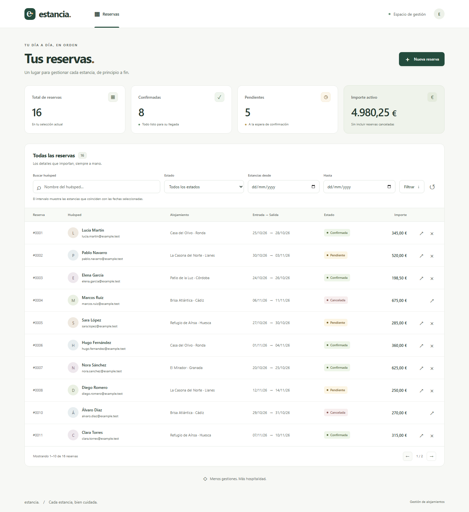

# Estancia

Aplicación de reservas de alojamiento para la prueba técnica de MisterPlan. PHP nativo, MySQL/MariaDB, Twig y JavaScript vanilla. Interfaz en español, renderizado inicial en servidor y operaciones asíncronas sobre una API JSON.

**Repositorio:** [guiller91/Proyecto-Dani](https://github.com/guiller91/Proyecto-Dani)

**Demo pública:** pendiente de asignar un hosting con PHP y MySQL. El repositorio incluye el despliegue completo con Docker y una guía para hosting convencional; una URL local no se presenta como despliegue público.



## Arranque con Docker

Requiere Docker Engine/Desktop y Compose v2. No necesitas instalar PHP, Composer ni MySQL en el equipo.

```sh
git clone https://github.com/guiller91/Proyecto-Dani.git
cd Proyecto-Dani
cp .env.example .env
# Editar DB_PASSWORD y DB_ROOT_PASSWORD en .env.
docker compose up --build -d
```

Abrir **http://127.0.0.1:8080**. La primera ejecución importa automáticamente las tablas y 16 reservas ficticias. La base de datos persiste en un volumen; el SQL de inicialización solo se ejecuta al crear ese volumen. La base de datos no expone un puerto al exterior y la aplicación se vincula a localhost.

```sh
docker compose logs -f app
docker compose stop
docker compose start
```

No borres el volumen si necesitas conservar reservas. Cambiar las contraseñas del `.env` no cambia las de una base de datos ya inicializada.

## Arranque local con PHP, MAMP o WAMP

Requisitos: **PHP 8.3 o superior**, Composer 2 y **MySQL 8.0.16+ o MariaDB 10.6+**, con InnoDB. Extensiones PHP: `pdo_mysql`, `mbstring` y las habituales `json`, `session`, `filter`. Para ejecutar PHPUnit se necesitan además DOM, XML y XMLWriter. Node.js 22+ solo es necesario para las pruebas de navegador y el formateo; la aplicación no tiene proceso de compilación frontend.

1. Crear una base de datos vacía y un usuario con permisos de importación. Por ejemplo, desde una sesión administrativa de MySQL/MariaDB:

   ```sql
   CREATE DATABASE reservas CHARACTER SET utf8mb4 COLLATE utf8mb4_unicode_ci;
   CREATE USER 'reservas'@'127.0.0.1' IDENTIFIED BY 'elige-una-clave';
   GRANT ALL PRIVILEGES ON reservas.* TO 'reservas'@'127.0.0.1';
   ```

   El host del usuario debe coincidir con cómo se conecta PHP. En MAMP/WAMP puede ser `localhost` y el puerto puede ser diferente de 3306.

2. Instalar dependencias y configurar la conexión:

   ```sh
   composer install
   cp .env.example .env
   ```

   En PowerShell, utilizar `Copy-Item .env.example .env`. Editar `DB_HOST`, `DB_PORT`, `DB_DATABASE`, `DB_USERNAME` y `DB_PASSWORD`. Las variables del entorno del proceso prevalecen sobre el fichero.

3. Importar **una sola vez** el fichero `database/database.sql` mediante la pestaña Importar de phpMyAdmin, el cliente MySQL o el importador incluido:

   ```sh
   php bin/import.php
   ```

   El importador se niega a sobrescribir una base de datos que ya contenga tablas. El fichero incluye DDL y datos de ejemplo; no necesita comandos de creación de base de datos ni privilegios globales.

4. Arrancar:

   ```sh
   composer serve
   # Equivalente:
   php -S 127.0.0.1:8080 -t public public/router.php
   ```

   Abrir **http://127.0.0.1:8080**. En Apache, configurar el DocumentRoot en `public/`, habilitar `mod_rewrite` y permitir `.htaccess`. No servir la raíz del repositorio. Ver [despliegue](docs/DEPLOYMENT.md).

Después de importar, el usuario de ejecución solo necesita `SELECT`, `INSERT` y `UPDATE`. Se recomienda retirar los permisos de DDL en un entorno público.

## Qué incluye

- Listado paginado con filtros combinables por estado, coincidencia de estancia y nombre del huésped.
- Creación, confirmación y cancelación, con estado y versión controlados en el servidor.
- Historial persistente y transaccional: el cambio y su evento se confirman juntos o se revierten juntos.
- Listado y detalle renderizados con Twig, plantilla base y parciales. No se usa `|raw`.
- Formularios accesibles, validación cliente/servidor, diálogos de confirmación, indicadores de carga y errores de API/red.
- Resumen calculado sobre todas las reservas filtradas, no solo sobre la página visible. El importe activo excluye las canceladas.
- Datos ficticios variados, pruebas unitarias, de integración y de navegador, análisis estático nivel 8 y CI.

## Decisiones y reglas

**Arquitectura.** `Kernel` resuelve rutas y centraliza errores; `ReservationController` adapta HTTP y Twig; `ReservationService` aplica transiciones y transacciones; `ReservationRepository` contiene SQL parametrizado. Los objetos de entrada y filtros realizan validación antes del acceso a datos. La composición de dependencias está en `Application`; no hay framework, ORM ni contenedor de servicios. Twig y dotenv son las únicas bibliotecas de producción. Las herramientas de desarrollo pueden tener sus propias dependencias Symfony, que no forman parte del runtime web.

**MySQL/MariaDB.** Se ajusta al enunciado y proporciona claves foráneas, restricciones y transacciones InnoDB. `DECIMAL(10,2)` mantiene importes exactos. Los importes de API son cadenas decimales; los agregados también se calculan en SQL sin sumar floats en PHP.

**Estados.** Toda reserva empieza `pendiente`. Se permite pendiente → confirmada, pendiente → cancelada y confirmada → cancelada. La cancelación es final. Repetir el mismo estado con la versión actual es un no-op: no aumenta versión ni duplica historial.

**Concurrencia.** El cliente envía `version` al cambiar el estado. La transacción bloquea la fila con `SELECT … FOR UPDATE`, comprueba la versión y actualiza el estado y su evento. Una vista obsoleta obtiene `409` y debe actualizarse. Dos cambios basados en la misma versión no pueden sobrescribirse silenciosamente.

**Fechas.** Fechas reales `AAAA-MM-DD`, años 1000–9999 y salida estrictamente posterior a entrada. Se admiten estancias pasadas. El intervalo de una estancia es `[entrada, salida)`: la fecha de salida no es una noche ocupada. Los filtros representan días inclusivos: `salida > desde` y `entrada <= hasta`. Un único límite también es válido. No hay inventario de habitaciones ni comprobación de disponibilidad: el alojamiento es un nombre, no un recurso reservado de forma exclusiva.

**Dinero.** Euros, de 0 a 99.999.999,99, máximo dos decimales. La API usa punto decimal y cadenas, por ejemplo `"198.50"`; se admiten enteros JSON para importes enteros. Los números JSON con fracción se rechazan deliberadamente para evitar ambigüedad de precisión. La interfaz adapta su campo numérico al contrato. No hay cobros, impuestos ni cálculo automático de tarifas.

**Búsqueda y orden.** Coincidencia parcial literal por nombre, sin distinguir mayúsculas ni acentos según la colación `utf8mb4_unicode_ci`. `%`, `_` y `!` se escapan como literales. Orden por creación descendente y, como desempate, ID descendente. Hasta 100 resultados por página; una página fuera del rango se ajusta a la última.

**Tiempo.** Base de datos y API en UTC; marcas de tiempo JSON con `Z`. Las vistas convierten los eventos a `APP_TIMEZONE` (Europe/Madrid por defecto); las fechas de entrada y salida son días de calendario sin conversión horaria.

**Seguridad.** Consultas preparadas reales, validación de tipos y longitudes, rechazo de campos inesperados al escribir, límite de JSON de 16 KB, escape automático de Twig y `textContent` en JS. CSP sin scripts inline, cabeceras de protección, respuestas sin caché y errores públicos sin SQL ni trazas. Cookies HttpOnly/SameSite, modo estricto de sesión y token CSRF para escrituras; no se habilita CORS. La sesión se cierra antes de las consultas para no serializar peticiones del mismo navegador.

**Alcance de acceso.** Es una demo de gestión sin autenticación: cualquiera que acceda puede leer y modificar las reservas ficticias. CSRF protege el contexto del navegador, no identifica ni autoriza usuarios. No se deben introducir datos personales reales en una demo pública. Antes de un uso real añadiría autenticación, autorización y aislamiento entre organizaciones.

## API

Contrato completo y ejemplos en [docs/API.md](docs/API.md).

| Método | Ruta | Resultado |
| --- | --- | --- |
| GET | `/api/session` | Cookie de sesión y token CSRF |
| GET | `/api/reservas` | Listado, paginación y resumen |
| GET | `/api/reservas/{id}` | Reserva con historial |
| POST | `/api/reservas` | Crear; devuelve `201` y `Location` |
| PATCH | `/api/reservas/{id}/estado` | Confirmar o cancelar con control de versión |

Vistas HTML: `/` (también `/reservas`) y `/reservas/{id}`. Los filtros se reflejan en la URL y pueden compartirse. Sin JavaScript, el listado, el filtrado por envío del formulario y el detalle siguen disponibles; las escrituras requieren JS.

## Pruebas y calidad

Las pruebas de integración **eliminan los registros de su base de datos de prueba** antes de cada caso. Hay una salvaguarda obligatoria: `APP_ENV=test` y nombre terminado en `_test`. Nunca apuntarlas a la base de datos de trabajo.

Crear una base independiente `reservas_test`, configurar un usuario con permisos sobre esa base (incluido `TRIGGER` para simular fallos), copiar `.env.test.example` a `.env.test` y ajustar la conexión:

```sh
php bin/import.php --test
composer check
```

`composer check` comprueba sintaxis, PHPUnit, PHPStan nivel 8 y formato PSR-12. Si no hay configuración de prueba, las pruebas de integración se marcan como omitidas; las unitarias siguen funcionando. Para ejecutar solo las unitarias: `composer test -- --testsuite Unit`.

```sh
npm ci
npx playwright install chromium
npm run test:e2e
```

Playwright arranca su propio servidor en `127.0.0.1:8081`, hereda la configuración de `.env.test` y exige una BD de prueba. Ejecutarlo después de PHPUnit, no en paralelo sobre la misma base de datos. Crea registros adicionales en esa base; no modifica los datos de la aplicación local. Recorre los flujos de usuario en Chromium de escritorio y emulación móvil, comprueba errores y conflictos, XSS y accesibilidad automatizada con axe. Una auditoría automática no sustituye una revisión manual de accesibilidad.

```sh
composer style
npm run format:check
composer audit
```

La CI reproduce las pruebas en PHP 8.3/8.4/8.5, MariaDB 11.4 y MySQL 8.4, y construye el contenedor con una prueba de arranque. Ver [verificación](docs/VERIFICATION.md) para los resultados realmente ejecutados.

## Si recibiera 1.000 reservas por hora

Son unas 0,28 creaciones por segundo de media; mediría los picos y el tráfico de lecturas antes de introducir infraestructura adicional. Mantendría la creación y su historial síncronos y transaccionales.

1. Apache/PHP-FPM y OPcache, límites de conexiones, HTTPS y métricas de latencia, errores, bloqueos y consultas lentas.
2. Revisar planes de ejecución e índices con el tráfico real. El listado ya pagina, pero los agregados y la búsqueda `%texto%` pueden recorrer muchas filas. Limitaría intervalos o introduciría una estrategia de búsqueda adecuada si los datos lo justifican.
3. En listados grandes sustituiría OFFSET por paginación por cursor. Separaría métricas de panel y listados si calcular el resumen en cada petición resultara caro.
4. Añadiría claves de idempotencia para creación y una política explícita de reintentos, para resolver respuestas perdidas sin duplicar reservas.
5. Emails y tareas externas irían a una cola mediante patrón outbox; no enviaría emails dentro de la transacción de reserva.
6. Autenticación, permisos, límites de frecuencia, backups con restauración comprobada y gestión de secretos. Si hubiera varios nodos web, compartiría sesiones o adaptaría la protección CSRF al mecanismo de autenticación elegido.

## Con más tiempo

Añadiría autenticación y permisos, migraciones incrementales, idempotencia de creación, búsqueda e informes para volúmenes mayores, pruebas de concurrencia bajo carga y un flujo de CI/CD vinculado al hosting definitivo. Si el producto requiriese disponibilidad real, modelaría alojamientos/unidades e impediría sobreventa con reglas y bloqueos específicos. No añadiría pagos ni un modelo de inventario solo por anticipación.

La creación y el historial son atómicos. El resumen y las filas del listado se consultan por separado y pueden reflejar instantes ligeramente distintos si hay escrituras concurrentes; para un panel con coherencia estricta utilizaría una transacción de lectura con snapshot.
